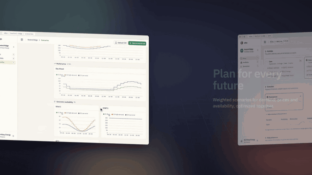

# Odys UI

A web workspace for energy portfolio optimization, built on the open-source [`odys`](https://github.com/ramirocrc/odys) library. Model your assets, define scenarios, run the optimizer and explore the results without writing scripts.



The full promo video is in [`media/odys-promo-readme.mp4`](media/odys-promo-readme.mp4).

## Quick start

```bash
# backend: http://localhost:8000
cd backend
uv sync
uv run uvicorn --app-dir src odys_ui.main:app --reload --port 8000

# frontend: http://localhost:3000 (in a second terminal)
cd frontend
npm install
npm run dev
```

See [`backend/README.md`](backend/README.md) and [`frontend/README.md`](frontend/README.md) for details.

## Contributing

Contributions are welcome. See [CONTRIBUTING.md](CONTRIBUTING.md).

## License

[MIT](LICENSE). Odys UI builds on [`odys`](https://github.com/ramirocrc/odys), which is also MIT-licensed.
